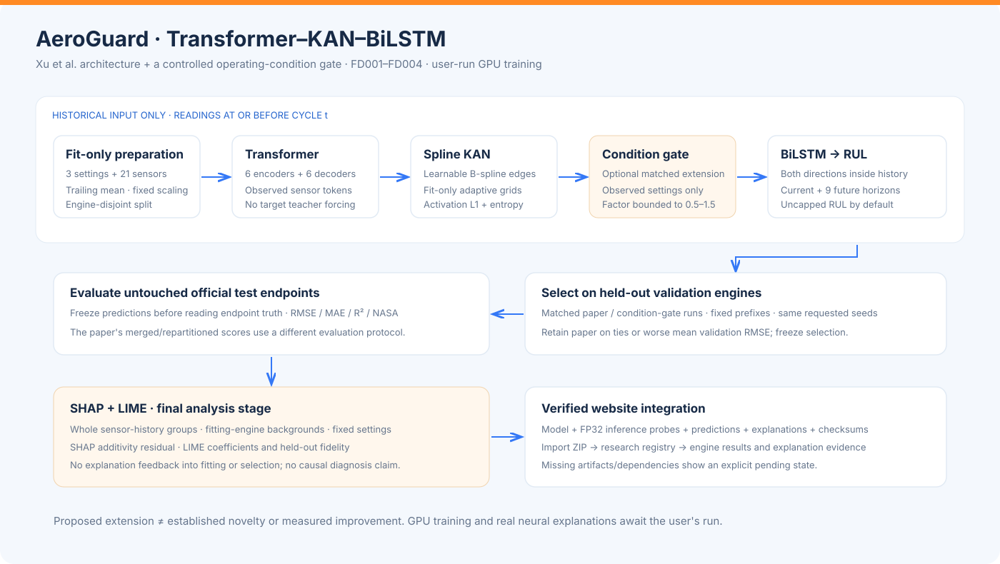

# AeroGuard

### Predictive maintenance intelligence for a connected fleet

[](https://github.com/vishal88736/aeroguard-predictive-maintenance/actions/workflows/ci.yml)

AeroGuard connects NASA C-MAPSS sensor histories to remaining useful life (RUL) prediction, anomaly detection, Python triage rules, and simulated maintenance work orders. A responsive **white, blue, and orange** interface makes datasets, models, decisions, and experiments inspectable.

The selected GPU research workflow implements **Transformer → KAN → BiLSTM**, compares a proposed operating-condition gate against the paper architecture, and runs **SHAP and LIME after training and evaluation**.

Built as an independent implementation of the Tata Elxsi TELEIPORT case study, **“Self-Healing Machines: Predictive Maintenance for a Connected Fleet.”**


*Historical CPU benchmark screenshot from local evaluation. A fresh checkout contains source and labelled demonstration examples; datasets, trained weights, and maintenance databases are not bundled.*

## Contents

- [What works](#what-works)
- [Quick start](#quick-start)
- [Prepare the data](#prepare-the-data)
- [Train the GPU research model](#train-the-gpu-research-model)
- [Import model results into the website](#import-model-results-into-the-website)
- [CPU baseline and maintenance pipeline](#cpu-baseline-and-maintenance-pipeline)
- [Architecture](#architecture)
- [Evaluation boundaries](#evaluation-boundaries)
- [Testing](#testing)
- [API](#api)
- [Repository structure](#repository-structure)
- [Configuration and publication scope](#configuration-and-publication-scope)
- [References and licensing](#references-and-licensing)

## What works

| Area | Implementation |
| --- | --- |
| Fleet exploration | Searchable engines, dataset/severity/cycle filters, sensor trends, RUL histories and alerts |
| Dataset management | FD001–FD004 import, schema/duplicate/missing-value checks, previews and preprocessing logs |
| CPU ML | Histogram gradient boosting, separate Isolation Forest, independent calibration and actual saved evaluation |
| GPU research | Standalone CUDA notebook, Transformer–KAN–BiLSTM, reference/extension runs and checkpoint resume |
| Explanations | Genuine Kernel SHAP/LIME final-stage code, fitting-engine backgrounds and separate fidelity evidence |
| Maintenance | Python rules, persistence, deduplicated simulated orders, assignment, resolution and audit |
| MLOps | Versioned artifacts, CPU MLflow tracking, background jobs, guarded baseline promotion and rollback |
| Research integration | Verified notebook ZIP imports, result/engine views and optional TorchScript prefix inference |
| Interface | Ten routes, persistent sidebar, Inter typography, local Lucide icons and responsive layouts |

**Execution status:** the CPU pipeline has been trained and evaluated locally. The GPU notebook has empty outputs; CUDA training, neural exports, real neural SHAP/LIME results, and any benefit from the proposed extension remain unverified until you run it. Missing artifacts/dependencies produce explicit pending states.

## Quick start

Requirements: **Python 3.12**. The browser application needs no Node.js, frontend build, or CUDA.

```bash
git clone https://github.com/vishal88736/aeroguard-predictive-maintenance.git
cd aeroguard-predictive-maintenance

python3.12 -m venv .venv
.venv/bin/python -m pip install --cache-dir .venv/cache/pip -r requirements-app.txt
cp .env.example .env
.venv/bin/python -m aeroguard --port 8765
```

Open **http://127.0.0.1:8765**. Interactive API documentation is at **http://127.0.0.1:8765/docs**.

On Windows, use `py -3.12 -m venv .venv`, `.venv\Scripts\python.exe`, and `copy .env.example .env` for the equivalent commands.

To explore immediately, select **Demo examples** in the top bar. Those signals and orders are explicitly synthetic and isolated from benchmark results. Starting the app downloads no dataset and starts no training.

| Route | Purpose |
| --- | --- |
| `/` | Landing page and functional dashboard/pipeline entry points |
| `/dashboard` | Fleet health, RUL distribution, alerts, orders and pipeline state |
| `/engines` | Engine search and filters |
| `/engines/:engineId` | Sensor readings, settings, RUL, decisions and order history |
| `/analytics` | RUL/anomaly distributions and measured model comparisons |
| `/models` | CPU registry, GPU exports, explanations and retraining controls |
| `/work-orders` | Acknowledge, assign, start and resolve simulated records |
| `/pipeline` | Background execution, stage details, errors and retries |
| `/data` | Dataset upload, validation, previews and feature preparation |
| `/settings` | Workspace, triage thresholds and pipeline settings |

## Prepare the data

Obtain the [NASA C-MAPSS dataset](https://data.nasa.gov/dataset/cmapss-jet-engine-simulated-data) separately. Place these twelve files in `data/cmapss/`, or import their ZIP through **Dataset Management**:

```text
train_FD001.txt  test_FD001.txt  RUL_FD001.txt
train_FD002.txt  test_FD002.txt  RUL_FD002.txt
train_FD003.txt  test_FD003.txt  RUL_FD003.txt
train_FD004.txt  test_FD004.txt  RUL_FD004.txt
```

Sensor files have **26 columns**: engine ID, observed cycle, three settings and 21 sensors. `RUL_FDxxx.txt` supplies one endpoint evaluation target per test engine. Training trajectories are complete; test trajectories stop before failure. Training labels and test targets are handled separately.

| Subset | Training engines | Test engines | Conditions | Fault modes |
| --- | ---: | ---: | ---: | ---: |
| FD001 | 100 | 100 | 1 | 1 |
| FD002 | 260 | 259 | 6 | 1 |
| FD003 | 100 | 100 | 1 | 2 |
| FD004 | 249 | 248 | 6 | 2 |

These counts match the locally validated files; a portal description may reverse the FD004 counts. The loader reports the supplied corpus. Raw sensor names and documented engineering mappings are preserved; arbitrary sensors are not renamed vibration or motor current.

Normalization, constant removal and learned preprocessing use fitting engines only. Windows use observed history. See [data instructions](data/cmapss/README.md) and [ML protocol](docs/ML_PROTOCOL.md).

## Train the GPU research model

Open **[Transformer_KAN_BiLSTM_GPU.ipynb](notebooks/Transformer_KAN_BiLSTM_GPU.ipynb)**. The model, preprocessing, training, evaluation, export and explanation code are inline.

Create a separate CUDA environment manually:

```bash
python3.12 -m venv .venv-kan
.venv-kan/bin/python -m pip install --cache-dir .venv-kan/cache/pip torch==2.14.1 --index-url https://download.pytorch.org/whl/cu130
.venv-kan/bin/python -m pip install --cache-dir .venv-kan/cache/pip -r requirements-kan.txt
.venv-kan/bin/python -m ipykernel install --prefix .venv-kan --name kan-bilstm --display-name "KAN BiLSTM CUDA"
.venv-kan/bin/python -m jupyterlab notebooks/Transformer_KAN_BiLSTM_GPU.ipynb
```

The wheel command targets CUDA 13.0. Choose a compatible wheel for your driver/platform using the [official PyTorch installer](https://pytorch.org/get-started/locally/). Downloads can require several GB. Notebook cells never install packages or fetch datasets.

Select the CUDA kernel and configure `DATA_DIR`, `OUTPUT_DIR`, `SELECTED_SUBSETS`, `SEEDS` and `VARIANTS`. Defaults: four subsets × two variants × one seed, **eight sequential runs**, up to 50 epochs each. Start with FD001 for a smaller experiment. Microbatch 32 accumulates to effective batch 256; lower the microbatch for limited VRAM.

### Reference and proposed extension

- **`paper`**: six Transformer encoder and six decoder layers, adaptive cubic spline KAN, BiLSTM and RUL regression.
- **`conditioned_kan`**: the same model with a bounded gate driven by observed settings, applied to KAN features before BiLSTM.

Both use matched splits and training settings. The extension is retained only when mean validation RMSE improves; a tie or worse outcome retains the reference. Official test scores do not select the model. The gate is a proposed engineering extension, with no claimed research priority or measured improvement.

### Explanations are last

After fitting, selection and official evaluation, the notebook calls actual **`shap.KernelExplainer`** and **`lime.lime_base.LimeBase`**. Whole sensor histories form groups; fitting-engine windows provide backgrounds and settings remain fixed.

SHAP contributions, expectation and additivity residual are distinct from LIME coefficients, intercept and held-out fidelity. Poor fidelity is retained. These are local model explanations, not physical fault diagnoses.

See [the complete research workflow](docs/RESEARCH_WORKFLOW.md) for architecture choices, checkpoints, precision, export files, sampling budgets and differences from the paper.

## Import model results into the website

The notebook creates a checksummed ZIP per trained run. Open **Model Registry → Import training bundle**. Local exports under `artifacts/kan_bilstm/` are discovered automatically.

The API verifies files, hashes, model/config identity, source corpus, disjoint cohorts, frozen predictions, recomputed metrics, selection evidence and explanation provenance. The website provides curves, engine selection, sensors, SHAP/LIME and artifact downloads. Missing neural artifacts never receive example results.

For interactive neural inference, install app dependencies in the CUDA environment and run the API there:

```bash
.venv-kan/bin/python -m pip install --cache-dir .venv-kan/cache/pip -r requirements-app.txt
.venv-kan/bin/python -m aeroguard --port 8765
```

The API compares the TorchScript model with exported FP32 probes before inference. Research results retain their own view; the calibrated CPU maintenance pipeline has a separate protocol and active-model registry.

<details>
<summary>Research registry preview</summary>


*Recorded interface with an honest pending GPU-training state.*

</details>

## CPU baseline and maintenance pipeline

After importing data, choose **Models → Train a baseline**, or run:

```bash
.venv/bin/python -m aeroguard.train --subsets FD001 FD002 FD003 FD004 --iterations 100 --evaluate
```

The baseline uses 90 causal features, histogram gradient boosting, a separate early-prefix Isolation Forest and independent engine-level calibration. Roughly 60% of training engines fit models, 20% provide development evidence and 20% calibrate intervals. MLflow tracks actual CPU experiments locally.

Eligible Python triage decisions create simulated orders transactionally. Persistence, latches and immutable event IDs prevent duplicates. Assignment, status changes, resolution notes and audit are functional. Thresholds are configurable engineering assumptions.

Background jobs report stage status, durations, counts and errors. Baseline promotion uses compatible development RMSE/NASA evidence, retains previous versions and rejects worse candidates. No LLM or external dispatch system is involved.

## Architecture



| Layer | Stack |
| --- | --- |
| Browser | Buildless JavaScript/SVG, local Inter/Lucide; no runtime CDN |
| API | FastAPI, Pydantic, structured errors and a background worker |
| Data | Pandas, NumPy, explicit schema and engine-level splits |
| CPU ML | scikit-learn, independent anomaly detection and calibration |
| GPU research | PyTorch, Transformer–KAN–BiLSTM, condition-gate ablation |
| Explanations | SHAP and LIME, post-training only |
| Persistence | SQLite repositories, immutable artifacts and CPU MLflow tracking |

Further reading: [system architecture](docs/ARCHITECTURE.md), [research workflow](docs/RESEARCH_WORKFLOW.md), [API contract](docs/API_CONTRACT.md), [ML protocol](docs/ML_PROTOCOL.md), [references](docs/PAPER_REFERENCES.md).

## Evaluation boundaries

The selected paper combines and repartitions original train/test data. This notebook preserves the official test boundary and uses an engine-disjoint 80/20 train/validation split. Scores must not be ranked directly against the paper's different protocol. Unspecified details are documented as implementation choices.

RMSE/MAE use **cycles**, R² is dimensionless, and raw/capped metrics are separate. NASA score uses `error = prediction - truth`: negative errors contribute `exp(-error/13)-1`; positive late errors contribute `exp(error/10)-1`. Lower is better. Anomaly percentiles are not failure probabilities.

<details>
<summary>Historical measured CPU reference — not KAN results</summary>

Local official-endpoint evaluation, one last observed window per engine. These predictors were capped at 125 cycles; targets below are uncapped. Artifacts/data are not bundled in this public repository.

| Subset | RMSE | MAE | R² | NASA score ↓ |
| --- | ---: | ---: | ---: | ---: |
| FD001 | 14.3561 | 10.6238 | 0.88065 | 263.6018 |
| FD002 | 25.8850 | 17.1969 | 0.76833 | 7053.6293 |
| FD003 | 14.3739 | 11.2620 | 0.87943 | 311.4315 |
| FD004 | 27.0292 | 19.1435 | 0.75425 | 5389.0739 |

</details>

C-MAPSS is a historical simulated benchmark. AeroGuard replays cycles/batches; it does not receive physical live telemetry, repair machinery, establish a failure date or validate maintenance safety. No operational drift detector or public application deployment is claimed.

## Testing

```bash
.venv/bin/python -m unittest discover -s tests -v
.venv/bin/python scripts/build_kan_notebook.py
node scripts/check_frontend.cjs
python3 scripts/audit_public_tree.py
```

Tests cover data/schema checks, causal features, leakage boundaries, metrics, anomalies, calibration, triage, order deduplication, jobs, promotion, API errors, notebook structure and verified exports. Most use isolated fixtures. Real-corpus/PyTorch tests explicitly skip when unavailable.

Pre-publication local evidence: **119 discovered, 114 passed, 5 skipped** with the corpus; **63 application + 28 research/theme browser checks** passed across desktop/tablet/mobile. Result-view tests use labelled contract fixtures, not neural weights. See [VALIDATION.md](VALIDATION.md). Source-only CI additionally skips corpus-dependent tests.

### Browser contract tests

Node.js **20+** is needed only for development. This runner starts two temporary API instances and shuts them down afterward. It does not train models or change your real registry.

```bash
npm ci --ignore-scripts
PLAYWRIGHT_BROWSERS_PATH=.cache/ms-playwright npx playwright install --with-deps chromium
PLAYWRIGHT_BROWSERS_PATH=.cache/ms-playwright .venv/bin/python scripts/run_browser_contract.py
```

`PLAYWRIGHT_MODULE` / `CHROMIUM_EXECUTABLE` can select an existing installation. The separate `scripts/browser_aeroguard.cjs` suite requires a prepared development workspace and changes labelled demo records only.

## API

OpenAPI: `/docs` and `/openapi.json`.

| Endpoint group | Purpose |
| --- | --- |
| `/api/health`, `/api/dashboard`, `/api/engines`, `/api/analytics` | Status and fleet exploration |
| `/api/data`, `/api/data/import`, `/api/data/prepare` | Ingestion and preprocessing |
| `/api/models`, `/api/models/train`, `/api/models/promote` | CPU runs, retraining and promotion |
| `/api/pipeline/run`, `/api/jobs/{id}` | Execution and monitoring |
| `/api/orders`, `/api/orders/{id}` | Simulated maintenance management |
| `/api/research`, `/api/research/import`, `/api/research/runs/{id}` | GPU result bundles |
| `/api/research/runs/{id}/engines/{engineId}` | Sensor/result/explanation view |
| `/api/research/runs/{id}/predict` | Optional saved-model prefix inference |

Mutations require `X-AeroGuard-Client: dashboard` and same-origin requests. Retried jobs accept `Idempotency-Key`. Errors use `{error: {code, message, details}}`. This loopback demonstration has no production authentication layer.

## Repository structure

```text
aeroguard/       FastAPI, CPU ML, jobs, research imports and repositories
fleetpm/         Shared data/metrics, triage and earlier research workflow
frontend/        Current interface and local assets
notebooks/       Selected GPU notebook and earlier integrated notebook
data/cmapss/     Instructions; actual NASA files stay local
docs/            Architecture, protocols, API, references and screenshots
scripts/         Notebook generation, browser QA, packaging and publication checks
tests/           Unit/integration tests with isolated fixtures
web/             Retained legacy FleetPulse interface
.github/         Source-only and browser-contract CI
```

Dependency files: `requirements-app.txt` for API/CPU; `requirements-kan.txt` for selected GPU/XAI; `requirements.txt` for the earlier integrated experiment.

## Configuration and publication scope

Copy `.env.example` to `.env`. `FLEET_DATA_DIR`, `FLEET_ARTIFACT_DIR` and `FLEET_RUNTIME_DIR` select storage; `AEROGUARD_HOST` defaults to `127.0.0.1` and `AEROGUARD_PORT` to `8765`. Caches stay project-local. No cloud credentials are required.

Git excludes environments, data, weights, databases, logs, archives, supplied PDFs and original reference imagery. Authored diagrams and selected public-safe screenshots are included. `scripts/audit_public_tree.py` checks tracked paths, common credential patterns, private home paths, sizes and notebook outputs; it is a publication guard, not a comprehensive security assessment.

## References and licensing

Xu, Guo and Zhou, *Research on the Remaining Useful Life Prediction Algorithm for Aero-Engines Based on Transformer–KAN–BiLSTM*, Aerospace 12 (2025), 998. [DOI](https://doi.org/10.3390/aerospace12110998). Other sources and adaptation boundaries: [PAPER_REFERENCES.md](docs/PAPER_REFERENCES.md).

[NOTICE.md](NOTICE.md) records project/asset notices and third-party licenses. A repository-wide code license has not been selected. See [CONTRIBUTING.md](CONTRIBUTING.md) for development and reproducibility guidance.
