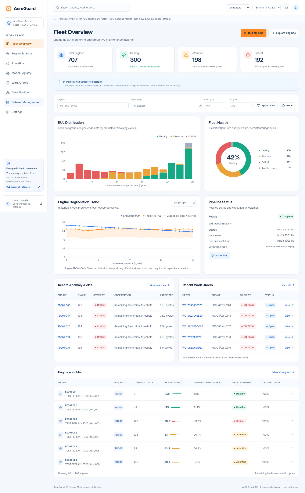
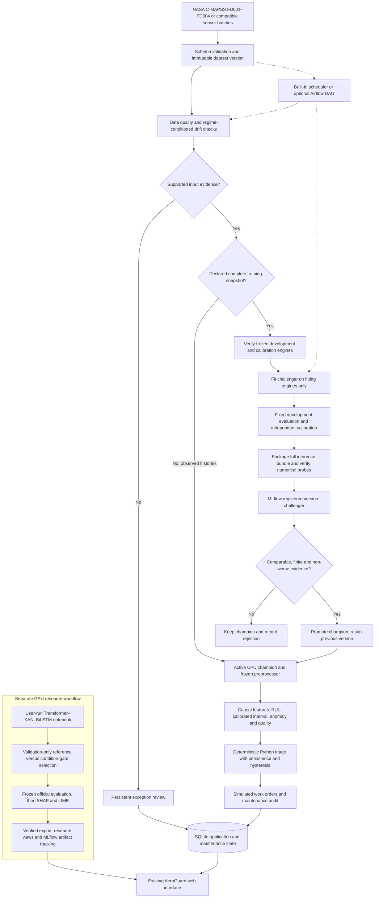
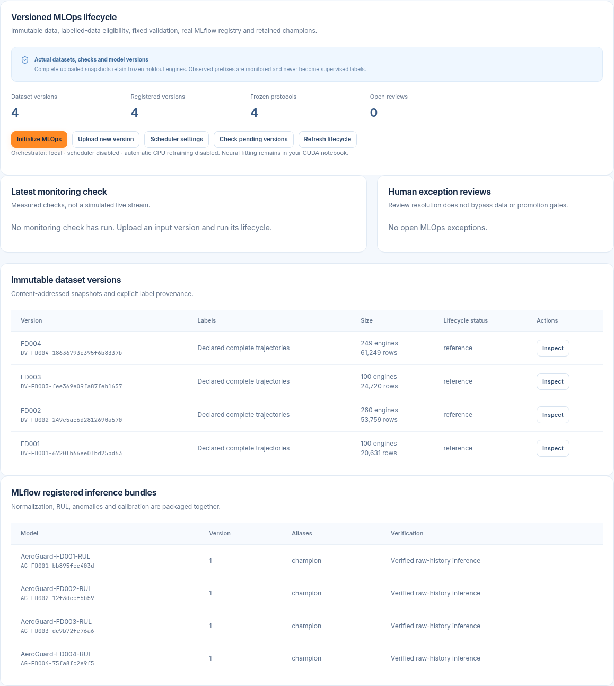
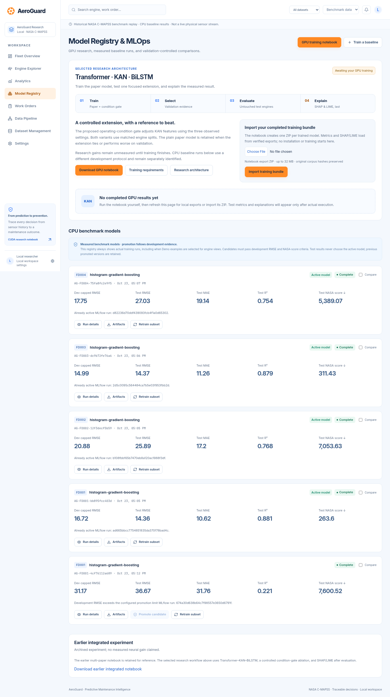

# AeroGuard

**Predictive maintenance intelligence for a connected fleet**

[](https://github.com/vishal88736/aeroguard-predictive-maintenance/actions/workflows/ci.yml)

AeroGuard turns NASA C-MAPSS engine histories into remaining useful life (RUL) estimates, anomaly evidence, deterministic triage decisions, and simulated maintenance work orders. Its versioned MLOps lifecycle connects data quality checks, drift screening, challenger training, MLflow registration, guarded promotion, and retained models for rollback.

The application uses **FastAPI and a responsive JavaScript interface** with the existing white, blue, and orange AeroGuard theme. It has ten working routes, persistent local storage, background jobs, and explicit missing-data/model states. There is no Streamlit application.

Built for the Tata Elxsi TELEIPORT case study, **“Self-Healing Machines: Predictive Maintenance for a Connected Fleet.”** This is an independent research implementation; maintenance records are local simulations.



*Historical screenshot of the actual CPU benchmark dashboard. A source checkout does not include NASA files, trained weights, experiment databases, or the maintenance records pictured here.*

## Contents

- [Implementation status](#implementation-status)
- [Architecture](#architecture)
- [Quick start](#quick-start)
- [Application navigation](#application-navigation)
- [Prepare the data](#prepare-the-data)
- [CPU baseline and maintenance pipeline](#cpu-baseline-and-maintenance-pipeline)
- [Versioned MLOps lifecycle](#versioned-mlops-lifecycle)
- [Train the GPU research model](#train-the-gpu-research-model)
- [Import model results into the website](#import-model-results-into-the-website)
- [Evaluation boundaries](#evaluation-boundaries)
- [API](#api)
- [Configuration and storage](#configuration-and-storage)
- [Repository structure](#repository-structure)
- [Testing](#testing)
- [Current limitations](#current-limitations)
- [Documentation and licensing](#documentation-and-licensing)

## Implementation status

| Component | Current implementation and evidence |
| --- | --- |
| Application | FastAPI serves the buildless frontend, typed APIs, background jobs, and SQLite repositories. Desktop, tablet, and mobile workflows have browser checks. |
| Dataset pipeline | FD001–FD004 validation, previews, fit-only preprocessing, engine-disjoint cohorts, causal features, and immutable uploaded versions. |
| Operational CPU models | Actual scikit-learn histogram gradient boosting, separate Isolation Forest, independent calibration, and saved evaluations. Four subset models have been trained locally. |
| Triage and work orders | Plain Python rules, quality exceptions, persistence/hysteresis, deduplication, assignment, resolution, and audit history. Orders are simulated. |
| MLOps | Frozen comparison protocols, engine/regime KS screening, complete MLflow inference packages, registry aliases, guarded CPU promotion, retry/recovery, and local scheduling. |
| Existing-model initialization | Four retained CPU champions were packaged, loaded, numerically checked, and registered locally; four reference datasets/protocols were created without refitting them. |
| GPU research | Standalone CUDA notebook for Transformer–KAN–BiLSTM and a proposed operating-condition gate. **Training and numerical CUDA execution remain pending.** |
| Neural explanations | Final-stage Kernel SHAP and LIME code and separate result views. **Actual neural explanation outputs require your trained export.** |
| Orchestration | Built-in scheduler and an optional Airflow 3 DAG/HTTP adapter. **The Airflow container has not been executed in this environment.** |

Scheduling and automatic retraining are **disabled by default**. A fresh checkout shows empty/pending benchmark states until data and artifacts are supplied. Labelled synthetic examples are available separately.

## Architecture

Training and serving use separate paths. Unlabelled observations can be monitored and served; only declared complete, eligible trajectories can supply supervised training labels.



The CPU champion is **HistGradientBoostingRegressor**, rather than XGBoost. The neural research contract remains separate: importing or tracking a GPU export does not automatically replace the calibrated maintenance model. Drift does not create failure labels, and resolving a review does not bypass training or promotion checks.

| Layer | Implemented stack |
| --- | --- |
| Browser | Buildless JavaScript modules and SVG charts; local Inter font and Lucide icons; shared sidebar, tables, dialogs, and light-theme styles |
| API and validation | FastAPI, Pydantic, structured JSON errors, OpenAPI, and same-origin mutation checks |
| Data engineering | Pandas, NumPy, explicit sensor schema, engine-aware transformations, and integrity-checked dataset manifests |
| CPU inference | scikit-learn histogram gradient boosting, K-means regime scaling, Isolation Forest, and split-conformal intervals |
| Monitoring | SciPy two-sample KS tests with Holm correction and minimum effect/sample-size requirements |
| Lifecycle and persistence | SQLite repository, durable jobs/audit, immutable model artifacts, local MLflow tracking and registry |
| Optional orchestration | Airflow 3 public SDK and a standard-library HTTP adapter; built-in polling otherwise |
| GPU research and explanations | PyTorch Transformer–KAN–BiLSTM, genuine cubic B-splines, post-training SHAP and LIME |

See [system architecture](docs/ARCHITECTURE.md), [MLOps design](docs/MLOPS.md), and [ML protocol](docs/ML_PROTOCOL.md) for implementation details.

## Quick start

Use **Python 3.12**. Running the application requires neither Node.js nor CUDA nor Docker. Install dependencies explicitly in a project environment:

```bash
git clone https://github.com/vishal88736/aeroguard-predictive-maintenance.git
cd aeroguard-predictive-maintenance

python3.12 -m venv .venv
.venv/bin/python -m pip install --cache-dir .venv/cache/pip -r requirements-app.txt
cp .env.example .env
.venv/bin/python -m aeroguard --port 8765
```

Open **http://127.0.0.1:8765**. API documentation is at **http://127.0.0.1:8765/docs**; health status is at **http://127.0.0.1:8765/api/health**.

On Windows, use `py -3.12 -m venv .venv`, replace `.venv/bin/python` with `.venv\Scripts\python.exe`, and use `copy .env.example .env`.

Select **Demo examples** in the top bar to explore labelled synthetic signals and simulated orders. Select **Benchmark replay** for actual imported datasets/models and lifecycle controls. Starting the application downloads no dataset and starts no training. Missing artifacts show a setup action instead of fabricated predictions.

## Application navigation

| Route | Function |
| --- | --- |
| `/` | Product landing page with dashboard and pipeline entry points |
| `/dashboard` | Fleet counts, health/RUL distributions, alerts, orders, and execution state |
| `/engines` | Searchable engine table with subset, severity, and cycle filters |
| `/engines/:engineId` | Sensor/settings histories, predictions, quality, decisions, and associated orders |
| `/analytics` | Measured RUL/anomaly distributions and saved subset evaluation results |
| `/models` | CPU runs/comparison, research exports/explanations, retraining, and MLOps lifecycle |
| `/work-orders` | Search, acknowledge, assign, start, resolve, and inspect simulated orders |
| `/pipeline` | Background runs, stage counts/timings, errors/retries, and lifecycle monitoring |
| `/data` | Import, schema checks, previews, feature preparation, and versioned batch upload |
| `/settings` | Workspace/policy settings and scheduler/monitoring configuration |

The **Versioned MLOps lifecycle** panel extends Models, Pipeline, Data, and Settings within the same application shell and theme.

## Prepare the data

Obtain the [NASA C-MAPSS dataset](https://data.nasa.gov/dataset/cmapss-jet-engine-simulated-data) separately. Put the twelve benchmark files in `data/cmapss/`, or import the compatible files/ZIP through **Dataset Management**:

```text
train_FD001.txt  test_FD001.txt  RUL_FD001.txt
train_FD002.txt  test_FD002.txt  RUL_FD002.txt
train_FD003.txt  test_FD003.txt  RUL_FD003.txt
train_FD004.txt  test_FD004.txt  RUL_FD004.txt
```

Each sensor row has **26 columns**: engine ID, observed cycle, `setting_1`–`setting_3`, and `sensor_1`–`sensor_21`. Headered CSV input must match the documented schema. Validation checks identities, cycle order, numeric fields, missing values, duplicates, and compatible endpoint-target counts.

| Subset | Training engines | Test engines | Operating conditions | Fault modes |
| --- | ---: | ---: | ---: | ---: |
| FD001 | 100 | 100 | 1 | 1 |
| FD002 | 260 | 259 | 6 | 1 |
| FD003 | 100 | 100 | 1 | 2 |
| FD004 | 249 | 248 | 6 | 2 |

Counts describe the locally validated corpus; the NASA portal description reverses the FD004 counts. The loader reports the supplied files rather than silently rewriting them. Support for all subsets means four separately fitted/evaluated tasks, not demonstrated transfer between fleets.

Training trajectories are complete: their retrospective label is `last_cycle - observed_cycle`. Official test histories are truncated; `RUL_FDxxx.txt` supplies one evaluation target at each test engine's final observed cycle. Test targets do not fit preprocessing, choose candidates, or calibrate intervals.

Sensor labels follow the C-MAPSS schema. For example, sensor 3 is **T30**, HPC outlet total temperature, and sensor 7 is **P30**, HPC outlet total pressure. Arbitrary channels are not relabelled vibration or motor current. Schema and unit mappings are centralized in `aeroguard/baseline.py`.

See [data preparation](data/cmapss/README.md) and [ML protocol](docs/ML_PROTOCOL.md). New batches for monitoring/retraining use **Upload new version**, described below, so the original benchmark files remain intact.

## CPU baseline and maintenance pipeline

1. Import the selected subset's train/test/RUL files in **Data** and inspect validation/preprocessing results.
2. Select **Benchmark replay**, then **Models → Train a baseline**. Choose subsets, configuration, and a reproducible seed.
3. Inspect the background job in **Pipeline**. Promotion uses development evidence before official endpoint evaluation.
4. Explore the resulting engines and predictions. Run a replay from **Pipeline** to persist triage decisions and eligible simulated orders.
5. Initialize the versioned lifecycle before using new-data retraining and registry aliases.

For reproducible fitting and optional official evaluation without the UI:

```bash
.venv/bin/python -m aeroguard.train --subsets FD001 FD002 FD003 FD004 --iterations 100 --evaluate
```

This CLI saves model artifacts and evaluation reports and tracks fitting by default. It does **not** activate models or run replay/promotion/registry packaging; use the application workflow for those operations.

### Features, anomaly detection, and uncertainty

The CPU model uses **90 causal features**: 21 current normalized sensors, 21 trailing means, 21 trailing standard deviations, 21 trailing slopes, three operating settings, observed fraction, observation gap, and capped observed age. The default trailing context is 30 cycles. Features never use a future cycle or eventual lifetime.

Learned transformations use fitting engines only. Operating settings define **one regime for FD001/FD003 and six for FD002/FD004**, with regime-specific sensor z-scores. Approximately 60% of original training engines fit models, 20% supply fixed development prefixes, and 20% independently calibrate intervals. Every engine stays in one cohort; fitting windows are weighted to balance engines. Default training RUL is capped at 125 cycles.

Isolation Forest is trained independently on early complete-context windows of fitting engines. These are **healthy proxies**, not verified fault-onset labels. Scores are empirical anomaly percentiles, not failure probabilities. Nominal 90% split-conformal intervals use reserved calibration engines and the capped target; unsupported quality or insufficient calibration remains an explicit exception.

### Deterministic triage and simulated maintenance

The non-LLM Python agent consumes predicted RUL, interval bounds, anomaly score, sensor-trend evidence, input quality, and the configured policy. Quality/warm-up checks precede maintenance action. Persistence, hysteresis, rearm rules, immutable event IDs, and an active-order latch suppress duplicate incidents.

Saved decisions include the inputs, evaluated/triggered rules, severity, explanation, recommended action, policy snapshot, engine, and timestamp. Orders support acknowledgement, owner assignment, in-progress/resolved states, outcome notes, and audit history. They are local simulated records: there is no external crew dispatch, actuator repair, or guaranteed physical failure date.

## Versioned MLOps lifecycle



*Actual local application after initialization: four immutable reference datasets, four frozen protocols, and four verified MLflow champion versions. Scheduling and automatic retraining are disabled; no incoming monitoring check is fabricated. These artifacts are not bundled in a source checkout.*

### Initialize and process a version

1. In **Benchmark replay**, open the lifecycle panel and click **Initialize MLOps**. Existing champions are packaged and verified without refitting; their training data and development/calibration cohorts become immutable references. Without a champion, initialization prepares a reference protocol for the first lifecycle fit.
2. Click **Upload new version**. Supply a 26-column sensor TXT/CSV, subset, cohort name, source provenance, and label declaration.
3. Inspect its manifest, then choose **Run lifecycle**. The background job records quality/drift checks and either inference/triage, eligible challenger fitting, or a review reason.
4. Inspect the resulting job, checks, registry version, promotion decision, and any reviews in the existing pages.

| Label declaration | Permitted behavior |
| --- | --- |
| `observed_prefix` | Monitor and serve actual champion predictions; persist triage and simulated orders. No supervised targets are inferred. |
| `complete_run_to_failure` | A complete training snapshot may train after frozen-cohort and quality checks. Completion is recorded operator provenance, not an inferred failure event. |

For observed batches, provide each engine's history from cycle one and keep a consistent cohort name as prefixes grow. Previously committed cycles are checked; altered history enters review, while replayed cycles do not create duplicate events. These engines appear in the explorer as **UPLOADED BATCH**, without invented true-RUL curves.

An updated complete snapshot must retain original engines and unchanged development/calibration trajectories; append new complete engine IDs to the fitting pool. Changed or missing holdouts block comparison. Official `test_*.txt` and `RUL_*.txt` cannot be declared labelled training inputs. A resolved work order is not automatically a run-to-failure training label.

### Data lineage and frozen evaluation

Each `DV-FD00x-…` version stores immutable content and a verified manifest with source/content hashes, label declaration, cohort, engine/row counts, missingness, and trajectory digests. Frozen protocols retain development/calibration membership, exact trajectory hashes, prefix cutoffs, window/target policy, and a protocol ID. New engines enter fitting only.

Run lineage records dataset/protocol IDs and code identity, including a working-source digest for uncommitted changes. Older runs retain unknown original revision information explicitly. Identical content can be reused; the original `data/cmapss/` corpus is preserved. This is **local content-addressed versioning**. DVC remotes and DagsHub are not implemented.

### Quality and drift screening

Drift comparisons use the champion's frozen preprocessor and one early-prefix median per engine, sensor, and operating regime. Histories shorter than the configured prefix are excluded. Existing reference engines are excluded from incoming complete-snapshot comparisons; overlapping windows are not counted as independent samples.

| Default check | Policy |
| --- | --- |
| Early reference context | First 30 observed cycles |
| Minimum population | 20 engine summaries in each compared population/regime |
| Statistical test | Two-sample KS; Holm correction across tested sensor/regime comparisons |
| Drift threshold | Adjusted p < 0.01 and KS statistic ≥ 0.2 on at least three distinct sensors |
| Missing sensor fraction | Above 2% requires review |
| Unsupported prefix settings | Above 5% requires review |

Reports distinguish stable, drift, insufficient data, and quality/reference failures. Independence of distinct engine cohorts and early-prefix suitability are assumptions. Statistical drift does not establish degraded RUL accuracy. **Unlabelled drift never authorizes supervised fitting; eligible new labelled data can justify fitting without significant drift.**

### Registry, promotion, and recovery

Real MLflow models are named `AeroGuard-FD001-RUL` through `AeroGuard-FD004-RUL`. Each portable Python-function package contains the RUL estimator, frozen preprocessing, feature configuration, anomaly reference, and calibration. It accepts raw 26-column observed histories starting at cycle one and returns one endpoint prediction/interval/anomaly/quality result per engine. The saved package is loaded and numerically probed before registration.

The versioned lifecycle uses **`challenger`**, **`champion`**, and retained **`previous`** aliases. Promotion requires compatible frozen cohorts/cutoffs/target contracts, finite independent calibration, and **non-worse development RMSE and NASA score**. Configurable nonnegative minimum improvement percentages can make the gate stricter. Official test targets never choose the champion. Rejected candidates retain their measured reason.

The application active-model pointer remains the serving authority. A deployment journal, alias compensation, and startup reconciliation handle interrupted promotion. Prior artifacts remain available for rollback. A completed candidate can be reused after downstream registration failure when data/configuration/code match; attempts and errors remain inspectable. This is a single-application-worker design, not distributed high availability.

Legacy baseline controls retain their explicit configurable promotion tolerances; the strict non-worse rule above describes the **versioned new-data lifecycle**.

### Scheduling and optional Airflow

**Scheduler settings** selects local polling or external Airflow, interval, bounded attempts, automatic retraining, and monitoring thresholds. Both scheduling and automatic retraining initially remain off. With scheduling on and retraining off, eligible observed-batch inference/triage and monitoring continue, while supervised fits are suppressed. Manual **Run lifecycle** is an explicit execution request.

The built-in scheduler polls the uploaded-version ledger, admits one backend job at a time, and uses persistent idempotency/attempt state. It is not a filesystem stream watcher. Selecting Airflow disables local polling.

For the optional **Linux-local** Airflow profile, start the AeroGuard API first, then run:

```bash
docker compose -f compose.mlops.yml up -d
docker compose -f compose.mlops.yml logs airflow
```

Follow the standalone initialization output for local access. Unpause **`aeroguard_closed_loop`**, then select Airflow and enable scheduling in AeroGuard. The hourly DAG calls `/api/mlops/tick`, polls durable jobs, propagates errors, and prevents overlapping DAG runs. Linux host networking reaches the loopback API; `AEROGUARD_API_URL` can change that target.

This command downloads the configured Airflow image and creates a named metadata volume. Stop it while retaining state with:

```bash
docker compose -f compose.mlops.yml stop
```

Compose configuration and the HTTP adapter were checked; the actual container/DAG runtime remains **unexecuted here because Docker-daemon access was unavailable**. Docker is optional for the core application. Full lifecycle details are in [MLOPS.md](docs/MLOPS.md).

## Train the GPU research model

Use **[Transformer_KAN_BiLSTM_GPU.ipynb](notebooks/Transformer_KAN_BiLSTM_GPU.ipynb)**. Its preprocessing, architecture, fitting, evaluation, exports, and explanations are inline. The notebook is supplied with empty outputs; you run the training yourself.

Create a separate environment and install CUDA PyTorch manually:

```bash
python3.12 -m venv .venv-kan
.venv-kan/bin/python -m pip install --cache-dir .venv-kan/cache/pip torch==2.14.1 --index-url https://download.pytorch.org/whl/cu130
.venv-kan/bin/python -m pip install --cache-dir .venv-kan/cache/pip -r requirements-kan.txt
.venv-kan/bin/python -m ipykernel install --prefix .venv-kan --name kan-bilstm --display-name "KAN BiLSTM CUDA"
.venv-kan/bin/python -m jupyterlab notebooks/Transformer_KAN_BiLSTM_GPU.ipynb
```

The example wheel targets CUDA 13.0; choose a compatible wheel/driver using the [official PyTorch installer](https://pytorch.org/get-started/locally/). Downloads can require several GB. No notebook cell installs dependencies or downloads datasets.

Select the CUDA kernel and set `DATA_DIR`, `OUTPUT_DIR`, `SELECTED_SUBSETS`, `SEEDS`, and `VARIANTS`. Defaults run four subsets × two variants × one seed: **eight sequential fits**, up to 50 epochs each, with resumable checkpoints. Begin with `SELECTED_SUBSETS = ["FD001"]` for a smaller experiment. The default microbatch is 32 with accumulation to effective batch 256; reduce it to 8 or 16 for limited VRAM.

### Reference and proposed extension

- **`paper`**: Transformer encoder/decoder with positional information, genuine adaptive cubic B-spline KAN, BiLSTM, and RUL regression.
- **`conditioned_kan`**: the same model with an observed-setting gate, `1 + 0.5 * tanh(MLP(settings))`, initialized to one before BiLSTM.

Matched configurations compare mean validation RMSE across the configured seeds; ties or worse outcomes retain the paper variant. Selection freezes before official evaluation. The gate is an engineering hypothesis, with no measured improvement or research-priority claim.

The notebook preserves the official test boundary and uses engine-disjoint 80/20 fitting/validation cohorts, fit-only min-max scaling, and trailing smoothing. Its default RUL target is uncapped. These choices differ from the calibrated CPU protocol and are recorded in exports. Mixed precision is used for fitting; evaluation/export probes/explanations use FP32. CUDA execution and numerical export compatibility still require your run.

### Explanations are last

After training, validation-only selection, and frozen official evaluation, the notebook uses actual **`shap.KernelExplainer`** and **`lime.lime_base.LimeBase`**. Whole sensor histories form perturbation groups; fitting-engine windows provide backgrounds and settings remain fixed.

SHAP expectation/contributions/additivity residual and LIME coefficients/intercept/held-out fidelity are reported separately. Poor fidelity is retained. These are local model explanations, not causal fault diagnoses or guaranteed component-routing evidence. SHAP/LIME do not enter the fitting loss or mandatory CPU triage path.

See [RESEARCH_WORKFLOW.md](docs/RESEARCH_WORKFLOW.md) for model dimensions, checkpoints, explanation budgets, source-paper adaptations, and export contracts.

## Import model results into the website

The selected notebook creates a checksummed ZIP per trained run. Open **Models → Import training bundle**. Local exports under `artifacts/kan_bilstm/` are also discovered automatically.

The API checks file hashes, model/config identity, corpus provenance, disjoint cohorts, frozen predictions, recomputed metrics, selection evidence, and explanation provenance. Research views show measured histories, engine results, sensors, SHAP/LIME, and downloadable artifacts. Missing neural results stay pending.

To use optional saved TorchScript prefix inference, install the app dependencies in the GPU environment and run the API there:

```bash
.venv-kan/bin/python -m pip install --cache-dir .venv-kan/cache/pip -r requirements-app.txt
.venv-kan/bin/python -m aeroguard --port 8765
```

The API compares saved-model outputs against FP32 export probes and requires the matching source data before inference. Viewing verified reports does not require fitting the model again.

Click **Track verified export** in the MLOps panel to log actual configuration, metrics, weights, preprocessing, training history, and final SHAP/LIME artifacts to the **`AeroGuard-CMAPSS-KAN`** MLflow experiment. Later explanation reports sync to the same run. Tracking is not GPU retraining or maintenance promotion: compatible independent calibration and a validated neural serving/promotion contract remain future work.

<details>
<summary>Research registry preview</summary>



*Recorded interface showing an explicit pending GPU-training state.*

</details>

## Evaluation boundaries

RMSE and MAE are measured in cycles; R² is dimensionless. Raw-target and capped-target metrics remain separate. The NASA score sums asymmetric errors across evaluation engines:

```text
d = predicted_RUL - true_RUL
penalty = exp(-d / 13) - 1   if d < 0
penalty = exp( d / 10) - 1   otherwise
NASA_score = sum(penalty)
```

Positive error overestimates remaining life and receives the stronger penalty. **Lower NASA score is better**; aggregate scores from differently sized cohorts are not directly comparable. Anomaly percentiles are not calibrated failure probabilities.

### Historical measured CPU reference

These are the initial local 100-iteration, single-seed CPU results, measured on 23 October 2026: **one final observed endpoint per official test engine**, uncapped supplied truth, and predictions capped at 125. They are not KAN results or measurements of the new retraining lifecycle. Data and fitted artifacts are excluded from the public repository.

| Subset | Test engines | RMSE | MAE | R² | NASA score ↓ |
| --- | ---: | ---: | ---: | ---: | ---: |
| FD001 | 100 | 14.3561 | 10.6238 | 0.88065 | 263.6018 |
| FD002 | 259 | 25.8850 | 17.1969 | 0.76833 | 7053.6293 |
| FD003 | 100 | 14.3739 | 11.2620 | 0.87943 | 311.4315 |
| FD004 | 248 | 27.0292 | 19.1435 | 0.75425 | 5389.0739 |

The selected paper merges/repartitions original training/test data. This notebook retains official test engines and uses a different grouped validation protocol, so results must not be ranked directly against that paper's reported scores. Numerical reproduction, superiority of KAN, and improvement from the proposed gate have not been established.

Conformal coverage assumes exchangeable, quality-qualified engine prefixes under the declared sampling policy. It does not guarantee coverage throughout an engine's trajectory or under field drift. Repeated tuning after inspecting official test results also forfeits an untouched-test claim.

## API

The running API exposes **`/docs`**, **`/openapi.json`**, and a health check. Public request models are in [contracts.py](aeroguard/contracts.py); frontend types are in [api.d.ts](frontend/api.d.ts). See the [API contract](docs/API_CONTRACT.md) and [schema snapshot](docs/openapi.json).

| Method and endpoint | Function |
| --- | --- |
| `GET /api/health` | Dependency/model readiness |
| `GET /api/dashboard`, `/api/engines`, `/api/engines/{asset}`, `/api/analytics` | Fleet views, filters, histories, and measured analytics |
| `GET /api/data`, `/api/data/{subset}/preview` | Dataset status and preview |
| `POST /api/data/import`, `/api/data/prepare` | Benchmark ingestion and preprocessing |
| `GET /api/models`, `/api/models/{run_id}` | CPU runs and evidence |
| `POST /api/models/train`, `/api/models/promote` | Baseline fitting, guarded promotion, or explicit rollback |
| `POST /api/pipeline/run`; `GET /api/jobs`, `/api/jobs/{job_id}` | Submit and inspect durable background work |
| `POST /api/jobs/{job_id}/retry` | Retry eligible failed/interrupted work |
| `GET /api/orders`, `/api/orders/{order_id}`; `PATCH /api/orders/{order_id}` | Simulated order views and lifecycle actions |
| `GET /api/mlops`; `PUT /api/mlops/settings` | Dataset/protocol/registry/check/review state and scheduler policy |
| `POST /api/mlops/bootstrap`, `/api/mlops/register` | Initialize references or package/register an existing CPU run |
| `POST /api/mlops/versions`; `GET /api/mlops/versions/{version_id}` | Upload an immutable version and inspect its manifest |
| `POST /api/mlops/run`, `/api/mlops/tick` | Explicit lifecycle execution or one scheduled submission |
| `POST /api/mlops/reviews/{review_id}/resolve` | Record review notes without bypassing eligibility gates |
| `GET /api/research`; `POST /api/research/import` | Verified GPU export catalogue/import |
| `GET /api/research/runs/{run_id}`, `/api/research/runs/{run_id}/engines/{engine_id}` | Research results, engine detail, and explanations |
| `GET /api/research/runs/{run_id}/predict`, `/api/research/runs/{run_id}/download` | Optional saved-model prefix inference and exported artifacts |
| `POST /api/mlops/research-track` | Log verified neural evidence to MLflow |
| `GET /api/settings`; `PUT /api/settings` | Workspace and maintenance policy |
| `GET /api/search`, `/api/notifications` | Shared search and notification controls |

Mutations require `X-AeroGuard-Client: dashboard`; browser requests must satisfy same-origin checks. Job submissions accept `Idempotency-Key` and return a job to poll rather than holding the request through training. Multipart version upload includes `file`, `subset`, `cohort`, `label_status`, and `provenance`.

Errors use `{ "error": { "code": "...", "message": "...", "details": ... } }`. Invalid input, conflicts, missing records, and unavailable optional inference dependencies remain explicit. This loopback application has no production authentication layer.

## Configuration and storage

Copy [.env.example](.env.example) to `.env`; do not commit real environment files. No cloud account or credentials are needed locally.

| Configuration | Purpose |
| --- | --- |
| `FLEET_DATA_DIR` | Benchmark corpus; default `data/cmapss` |
| `FLEET_ARTIFACT_DIR` | Models, tracking store, immutable versions, and protocols; default `artifacts` |
| `FLEET_RUNTIME_DIR` | Application/maintenance/job database and runtime state; default `runtime` |
| `AEROGUARD_HOST`, `AEROGUARD_PORT` | Default bind `127.0.0.1:8765`; CLI flags can override |
| `AEROGUARD_API_URL` | Optional Airflow HTTP adapter target |
| Cache variables in `.env.example` | Project-local pip, Torch, Jupyter, and other optional caches |
| Lifecycle settings in the UI/API | Persistent scheduling, retraining, statistical checks, and improvement thresholds |

Configure CUDA devices, batching and training through the selected GPU notebook's configuration cell. The application baseline runs on CPU. MLflow currently uses a local SQLite/artifact store under the configured artifact directory.

Generated state is separated from source:

```text
data/cmapss/                      Local NASA train/test/RUL files
artifacts/aeroguard/              CPU bundles, active.json, MLflow DB/artifacts
artifacts/mlops/datasets/         Content-addressed sensor snapshots/manifests
artifacts/mlops/protocols/        Frozen engine cohorts, hashes, and cutoffs
artifacts/mlops/lineage/          Existing-model lineage references
artifacts/kan_bilstm/             User-trained neural exports
references/                      Private user-supplied PDFs and reference image
output/presentation/             Completed Team Taj Mahal PowerPoint
runtime/aeroguard.sqlite          Jobs, policies, reviews, triage, orders, audit
```

Keep trusted model packages local: serialized model bytes are executable artifacts. Benchmark upload is a data-validation path, not an arbitrary joblib upload feature. When relocating a private project archive, initialize MLOps again to rebuild tracking/registry mappings from verified retained bundles; registration-only tracking preserves the original training ID without inventing another fitting run.

## Repository structure

```text
aeroguard/
  api.py, contracts.py            FastAPI routes and validated request models
  services.py, repository.py     Background jobs, application state, promotion
  baseline.py, datasets.py       CPU models, schema/features, evaluation
  mlops.py                       Lifecycle, scheduler, observed-batch serving
  mlops_data.py                  Immutable snapshots and frozen protocols
  mlops_monitoring.py            Data quality and engine/regime drift checks
  mlops_registry.py              Complete MLflow packages, aliases, neural tracking
  orchestration.py               Airflow HTTP adapter
  research.py                    Verified neural exports and optional inference
fleetpm/                         Shared data, preprocessing, metrics, demo signals, and triage storage
frontend/                        Current themed application, charts, API types, local assets
notebooks/                       Selected standalone GPU notebook and its percent-format source
dags/aeroguard_lifecycle.py       Optional hourly Airflow 3 lifecycle DAG
compose.mlops.yml                Optional Linux-local Airflow runtime
docs/                            Architecture, protocols, API, and the three README screenshots
scripts/                         Notebook generation, browser QA, packaging, publication checks
tests/                           Unit/integration tests using isolated temporary fixtures
.github/workflows/ci.yml         Source-only and isolated browser checks
```

| Dependency file | Scope |
| --- | --- |
| [requirements-app.txt](requirements-app.txt) | Current API, CPU pipeline, monitoring, and MLflow registry |
| [requirements-kan.txt](requirements-kan.txt) | Selected GPU notebook and final SHAP/LIME analysis; install compatible CUDA Torch explicitly |
| [requirements.txt](requirements.txt) | Default application entry point; includes requirements-app.txt |
| [package.json](package.json) | Development/browser checks only; no application frontend build |

## Testing

Run source checks from the repository root after setting up the application environment:

```bash
.venv/bin/python -m unittest discover -s tests -v
node scripts/check_frontend.cjs
.venv/bin/python scripts/audit_public_tree.py --worktree --history
```

To regenerate the notebook deterministically from its percent-format source:

```bash
.venv/bin/python scripts/build_kan_notebook.py
```

This generates the notebook; it does not execute training. Edit the percent-format source, keep outputs empty, and version configuration/export contracts when changing the model interface. The tests cover schema/invalid input, prefix invariance and leakage boundaries, actual isolated CPU fitting/calibration, metric direction, anomaly scores, triage persistence, order idempotency, jobs/failures, registry packaging, frozen cohorts, drift checks, retraining/rejection/recovery, APIs, and research export integrity.

### Recorded verification

After removing the retired implementation, verification on **28 October 2026** recorded:

| Check | Result and scope |
| --- | --- |
| Python suite with the local corpus | **120 discovered; 120 passed** |
| Disposable source-only checkout | **120 discovered; 118 passed, 2 corpus checks skipped** |
| Research/theme browser regression | **28 checks passed**, isolated contract fixtures |
| New MLOps browser workflows | **30 checks passed**, actual CPU fitting/MLflow on disposable synthetic data |
| Responsive/browser runtime | 1440, 1024, and 390 px; no JavaScript errors in those recorded runs |
| Actual retained CPU models | All five bundles passed integrity checks and matched one saved endpoint prediction each; four active champions retained without refitting |
| Preservation | Original twelve data files, five supplied PDFs, existing CSS/HTML, active pointer, and saved model bundle integrity retained |
| Optional Airflow | Compose configuration valid and HTTP adapter tested against a real local API; container/DAG not run |

Research UI fixtures contain labelled dummy model bytes and establish contract behavior only. Synthetic MLOps fitting is not a NASA accuracy measurement. Two real-corpus checks skip in a source-only clone. The selected notebook performs its own numerical GPU checks when the user runs it; this source/browser suite does not establish CUDA execution.

The CI badge reports the published GitHub revision, which may differ from local working changes; it is not evidence of GPU fitting or deployment. Keep fixture tests, local corpus results and user-run GPU measurements separate when reporting changes.

### Browser contract tests

Node.js **20+** is required only for development. Install browser tooling explicitly with project-local caches:

```bash
npm ci --ignore-scripts --cache .cache/npm
PLAYWRIGHT_BROWSERS_PATH=.cache/ms-playwright npx --no-install playwright install chromium
PLAYWRIGHT_BROWSERS_PATH=.cache/ms-playwright .venv/bin/python scripts/run_browser_contract.py
PLAYWRIGHT_BROWSERS_PATH=.cache/ms-playwright .venv/bin/python scripts/run_mlops_browser.py
```

`PLAYWRIGHT_MODULE` and `CHROMIUM_EXECUTABLE` can select an existing installation; the runner also detects `/usr/bin/chromium`. Browser/system dependencies must be present on your platform.

Both runners own temporary workspaces/API instances and shut them down afterward. The research runner tests labelled export contracts without neural fitting. The MLOps runner **does fit CPU models and register MLflow versions on disposable synthetic inputs**; it does not train CUDA models or change your real registry. The separate `scripts/browser_aeroguard.cjs` suite needs a prepared development workspace.

## Current limitations

- C-MAPSS is a historical simulated benchmark, replayed or uploaded in batches. There is no physical telemetry integration, real maintenance dispatch, validated field benefit, or automatic machine repair.
- CUDA fitting, real neural SHAP/LIME outputs, matched condition-gate benefits, and numerical TorchScript export compatibility await the user's GPU run. Paper scores are not substituted for local results.
- Neural tracking/result views are implemented, but calibrated neural maintenance promotion and automatic neural retraining are not. The current versioned challenger loop trains the CPU baseline.
- Drift thresholds, early-prefix healthy proxies, and triage thresholds are engineering assumptions. Statistical checks and nominal intervals are not field-safety guarantees.
- Airflow runtime execution, DVC remote storage, DagsHub integration, production authentication, distributed workers, and public application hosting are not established here. The built-in local lifecycle works without those services.

## Documentation and licensing

| Document | Content |
| --- | --- |
| [ARCHITECTURE.md](docs/ARCHITECTURE.md) | Application layers, serving/training separation, persistence, and design decisions |
| [MLOPS.md](docs/MLOPS.md) | Immutable data, frozen protocols, monitoring, registry, scheduling, recovery, and Airflow |
| [ML_PROTOCOL.md](docs/ML_PROTOCOL.md) | CPU features, engine splits, anomaly reference, calibration, and metrics |
| [RESEARCH_WORKFLOW.md](docs/RESEARCH_WORKFLOW.md) | Selected notebook, paper adaptations, ablations, explanations, and import/export |
| [API_CONTRACT.md](docs/API_CONTRACT.md) | API validation, jobs, errors, and endpoint behavior |

Asset provenance and third-party licenses are consolidated in [NOTICE.md](NOTICE.md).

Selected research reference: Xu, Guo and Zhou, *Research on the Remaining Useful Life Prediction Algorithm for Aero-Engines Based on Transformer–KAN–BiLSTM*, Aerospace 12 (2025), 998. [DOI](https://doi.org/10.3390/aerospace12110998).

Git excludes datasets, trained weights, local databases, logs, environment files, supplied PDFs, and original reference imagery. The publication audit checks common credential patterns, private paths, file sizes, documentation links, and empty notebook outputs; it is not a comprehensive security assessment.

[NOTICE.md](NOTICE.md) records project and third-party notices. Inter and Lucide retain their own licenses. **A repository-wide code license has not been selected.** Public visibility does not change those terms or imply NASA/Tata Elxsi affiliation.
