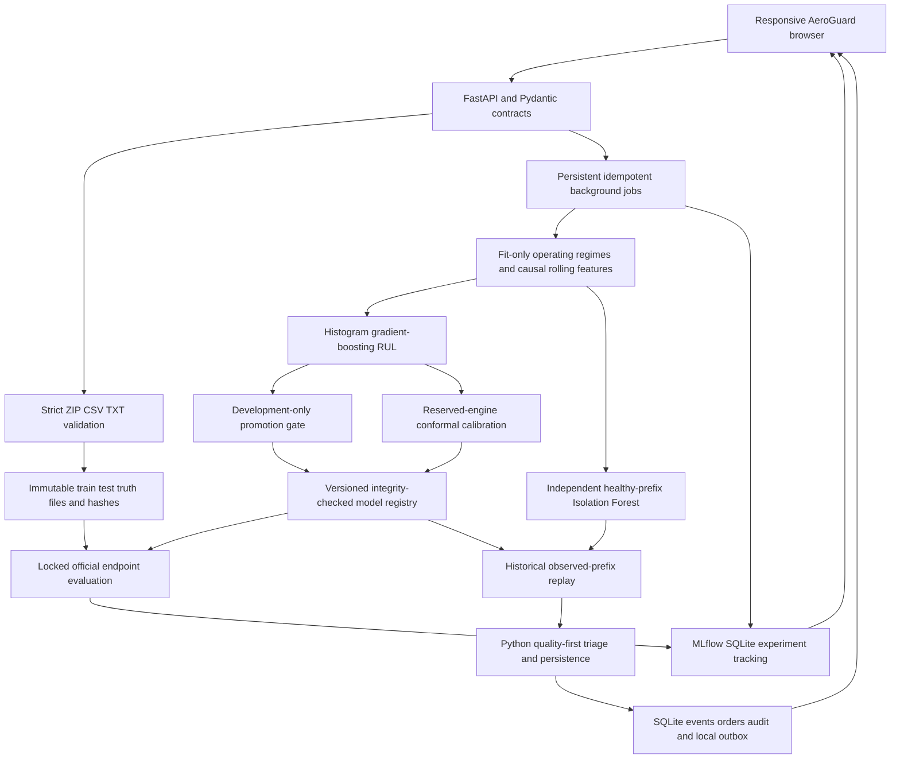

# AeroGuard implemented architecture

The measured application/maintenance baseline uses the following components. The selected Transformer–KAN–BiLSTM research workflow is documented in [RESEARCH_WORKFLOW.md](RESEARCH_WORKFLOW.md); its export registry, inference adapter and final SHAP/LIME stage remain distinct from the CPU calibration/triage protocol.

The job captures configuration, policy and active-model references at submission time. The same idempotency key reuses that immutable invocation, without importing changed settings. Jobs record real stage timestamps, duration, counts and errors. A restart marks interrupted work for explicit retry.

Numerical modules have no HTTP dependency. The repository isolates local SQLite persistence. Rules are ordinary Python with no LLM. Synthetic demo namespaces and benchmark simulation namespaces are separate throughout queries and mutations. Work orders are durable local simulated records, with no external dispatch.

Engine cohorts are separated before preprocessing and window sampling. Official test targets are parsed only after frozen predictions. Promotion uses development evidence and retains previous versions. Retrospective target curves stay in the evaluation/view layer and never enter triage input packets.

See [the readable SVG](architecture.svg), [ML protocol](ML_PROTOCOL.md), [API contracts](API_CONTRACT.md), and [MLOps lifecycle](MLOPS.md).
## Selected GPU research path, 24 October 2026

The primary notebook now follows Transformer–KAN–BiLSTM with a validation-controlled operating-condition gate ablation. SHAP and LIME are strictly post-training/post-evaluation. `aeroguard/research.py` validates notebook exports and provides model/engine/result APIs, optional verified TorchScript inference, and saved explanation evidence. `frontend/research.js` connects these functions to the shared blue/orange/white application shell. Missing training is an explicit pending state; the existing CPU baseline and its calibrated triage remain separately identified.

See [research workflow](RESEARCH_WORKFLOW.md) and [architecture diagram](research-architecture.svg) for exact module order, data boundaries, proposed extension, environment, artifacts and verification limits. The rest of this document describes the existing application/CPU pipeline.

## Versioned MLOps lifecycle

The application now includes immutable incoming datasets, frozen development/calibration protocols, regime-conditioned engine-level drift screening, actual MLflow registered inference bundles and aliases, durable scheduled jobs, exception review and new-data challenger fitting. The optional Airflow adapter calls the same lifecycle API. Observed batches serve the active CPU champion and retain their own histories without becoming supervised labels. See [MLOPS.md](MLOPS.md) for the current full diagram, promotion/recovery contracts, setup and execution boundaries. The existing frontend and theme remain in use.
