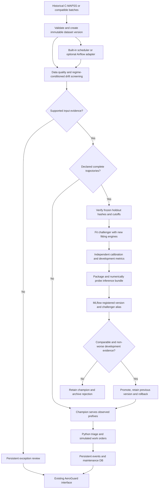

# AeroGuard MLOps lifecycle

The existing FastAPI application, JavaScript interface, sidebar, routes and blue/orange/white theme remain in use. MLOps panels extend Models, Pipeline, Data and Settings. There is no Streamlit application.

## Implemented architecture



Training and serving are separate invocations. Observed batches do not supply training labels. SHAP/LIME remain final neural analysis stages and are not mandatory dependencies of CPU triage.

## Initialize and upload

Start with `.venv/bin/python -m aeroguard --port 8765`. In **Benchmark replay**, select a subset and click **Initialize MLOps** in a lifecycle panel. The background job copies the original training input, freezes the recorded development/calibration engine identities and trajectory hashes, packages the existing champion, loads its actual MLflow package, verifies its RUL output and creates a real model version/champion alias. It does not refit the champion or change its active pointer. Without a champion, it creates a reference protocol for a subsequent first training run.

**Upload new version** accepts 26-column sensor TXT/CSV files with subset, cohort name, label declaration and source provenance. Original NASA files are preserved.

| Label declaration | Behavior |
| --- | --- |
| Observed prefixes | Quality/drift checks, actual champion inference, persistent triage and simulated orders. No supervised labels are inferred. |
| Complete run-to-failure | Full training snapshots become eligible after frozen-cohort checks. Completion is the operator's recorded declaration, not inferred physical truth. |

An updated complete snapshot must retain the original engine IDs and unchanged development/calibration trajectories. Append new complete engine IDs to the fitting pool. Changed fitting data is versioned; changed or missing holdouts block comparison. Official `test_*.txt` and `RUL_*.txt` cannot be declared labelled training inputs.

Observed batches supply the observed history of their engines. Use a consistent cohort name for growing prefixes. Rewriting committed history enters exception review. Replayed cycles do not create extra events/orders. Uploaded engines appear in the existing explorer with **UPLOADED BATCH** labels and no invented true-RUL curve.

Click **Run lifecycle** for explicit processing. Repeated requests with the same idempotency key reuse the recorded job. Identical champion training content skips redundant fitting unless `force_retrain` is explicitly requested.

## Data and model lineage

`artifacts/mlops/datasets/DV-…/` stores immutable files and integrity-checked manifests: content digest, schema, label declaration, source/cohort, counts, missingness and engine trajectory digests. Official evaluation targets are excluded. This is local content-addressed data versioning; DVC remote storage and DagsHub are not claimed.

`artifacts/mlops/protocols/` fixes development/calibration engine cohorts, numerical trajectory hashes, target convention and prefix cutoffs before learned preprocessing. New engines enter fitting only. Each model records dataset/protocol identifiers, source hashes and code identity. Git revision plus a working-source digest distinguish uncommitted code; older runs explicitly retain an unknown original training revision.

## Monitoring and statistical limits

The detector uses one median per engine, sensor and operating regime over an early observed prefix, transformed by the champion's frozen preprocessor. It does not treat overlapping rolling windows as independent observations. Histories shorter than the configured prefix are excluded from statistical comparisons. Existing reference engine IDs are excluded from complete incoming snapshot comparisons.

Two-sample KS comparisons use Holm correction across the tested sensor/regime family and a minimum effect size. Defaults: first 30 cycles, at least 20 engine summaries in each compared population/regime, adjusted p below 0.01, KS statistic at least 0.2, and three distinct flagged sensors. Raw missingness above 2% or unsupported prefix settings above 5% requires review.

These are configurable demonstration assumptions. Distinct engine cohorts are assumed independent. Early prefixes are healthy proxies, not onset labels. Checks report **insufficient_data**, **stable** or **drift**, without inventing significance for a small batch. Distribution change does not establish worse RUL accuracy or create labels. New complete labelled data can justify training without significant drift; unlabelled drift cannot justify supervised fitting.

## Registry, promotion and recovery

The existing local MLflow SQLite store now contains registered CPU models named `AeroGuard-FD001-RUL` through `AeroGuard-FD004-RUL`. The portable Python-function artifact packages preprocessing, feature configuration, RUL, independent anomaly detection and calibration. It accepts the 26 raw columns and observed histories starting at cycle one, then returns one endpoint per engine. Targets and pre-normalized feature matrices are not raw prediction inputs.

Versions use `challenger`, `champion` and retained `previous` aliases. New-data promotion requires identical frozen development/calibration cohorts, cutoffs and target convention, a finite independent calibration interval, and non-worse development RMSE **and** NASA score. Configurable nonnegative minimum improvement percentages can make either criterion stricter. Official test scores never choose the winner. Rejections retain their measured reason and prior champion.

The application's active pointer is its serving authority. Alias changes have compensation and a durable promotion journal. Startup reconciles interrupted deployment against that pointer. Promotion/audit rows share a database transaction; previous artifacts remain for rollback. Completed candidate checkpoints survive downstream registration failure. Retrying the same data/configuration/code reuses a verified fitted candidate. Jobs retain real stages, counts, timings and errors; interrupted work is inspectable and retryable. This is a single-application-worker demonstration, not distributed high availability.

## Scheduling and optional Airflow

Scheduling and automatic retraining start disabled. **Scheduler settings** selects the built-in worker or external Airflow, interval, bounded attempts and monitoring thresholds. The built-in worker polls new uploaded versions and admits one application job at a time. With automatic retraining off, checks and eligible observed-batch inference continue, but challengers are not trained. With it on, only new complete eligible snapshots may train. Disabling scheduling stops new scheduled submissions; an already running job may finish. Review resolution records notes without changing labels or bypassing gates.

`dags/aeroguard_lifecycle.py` uses Airflow 3's public SDK and `schedule` field. Its dependency-free HTTP adapter calls `/api/mlops/tick`, polls the durable job and propagates failures. The hourly DAG disallows overlap and has bounded retries. Choosing Airflow disables local polling.

With the API already running on Linux:

```bash
docker compose -f compose.mlops.yml up -d
docker compose -f compose.mlops.yml logs airflow
```

This optional command downloads Airflow and creates a named volume. Follow standalone initialization output for local access, unpause `aeroguard_closed_loop`, and enable Airflow scheduling in AeroGuard. Linux host networking allows access to the loopback API. This is a local demonstration profile. Stop it with `docker compose -f compose.mlops.yml stop` without deleting metadata.

The Airflow container was not executed in the implementation environment because Docker-daemon access was unavailable. Backend/browser verification works without Docker; adapter checks do not prove a live Airflow deployment.

## Neural experiments

Train the CUDA notebook yourself. After importing its verified export, **Track verified export** logs actual configuration, validation/official metrics, weights, history, preprocessing and SHAP/LIME artifacts to `AeroGuard-CMAPSS-KAN`. Adding explanations syncs another report revision to the same run. This tracks exported evidence; it does not execute GPU fitting or promote an uncalibrated neural model. The research split/target contract remains separate until compatible independent calibration and serving/promotion are validated. Fixture values never fill the real registry.

## API and verification

| Endpoint | Behavior |
| --- | --- |
| `GET /api/mlops` | Versions, protocols, checks, reviews, aliases and scheduler state |
| `POST /api/mlops/bootstrap` | Background snapshot/protocol initialization and champion registration |
| `POST /api/mlops/versions` | Multipart file, subset, cohort, label status and provenance |
| `GET /api/mlops/versions/{id}` | Integrity-checked manifest |
| `POST /api/mlops/run` | Background lifecycle; optional training settings, `force_retrain`, `monitor_only` |
| `POST /api/mlops/register` | Background complete CPU inference-bundle registration |
| `POST /api/mlops/research-track` | Verified notebook artifact tracking |
| `PUT /api/mlops/settings` | Typed scheduling and monitoring settings |
| `POST /api/mlops/tick` | Submit one pending version or report disabled/busy/idle |
| `POST /api/mlops/reviews/{id}/resolve` | Persist review notes without bypassing checks |

Existing mutation headers and job idempotency apply. No external credentials or maintenance dispatch connection is required.

```bash
.venv/bin/python -m unittest discover -s tests -v
node scripts/check_frontend.cjs
# Use an installed Playwright/Chromium or the README's manual browser setup.
.venv/bin/python scripts/run_browser_contract.py
.venv/bin/python scripts/run_mlops_browser.py
```

The MLOps browser runner owns a visibly labelled disposable synthetic workspace. It performs actual CPU fitting/MLflow registration through the existing UI. This verifies software behavior, not NASA accuracy or GPU performance. It installs no dependencies and starts no CUDA training.

References: [MLflow registry](https://mlflow.org/docs/latest/ml/model-registry/workflow/), [Python-function models](https://mlflow.org/docs/latest/api_reference/python_api/mlflow.pyfunc.html), [Airflow SDK](https://airflow.apache.org/docs/apache-airflow/stable/public-airflow-interface.html), [SciPy KS](https://docs.scipy.org/doc/scipy/reference/generated/scipy.stats.ks_2samp.html).

After relocating a private project archive, initialize MLOps to rebuild the local tracking/registry mapping from verified bundles. Registration-only runs retain original training-run identifiers as provenance and do not claim another model fitting execution.
